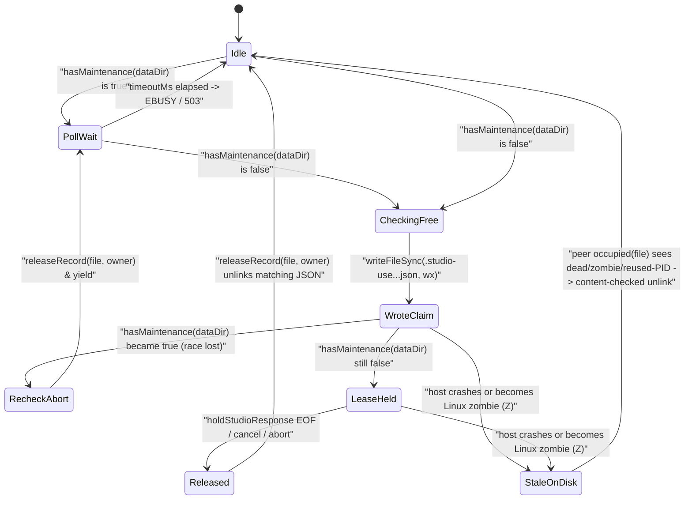
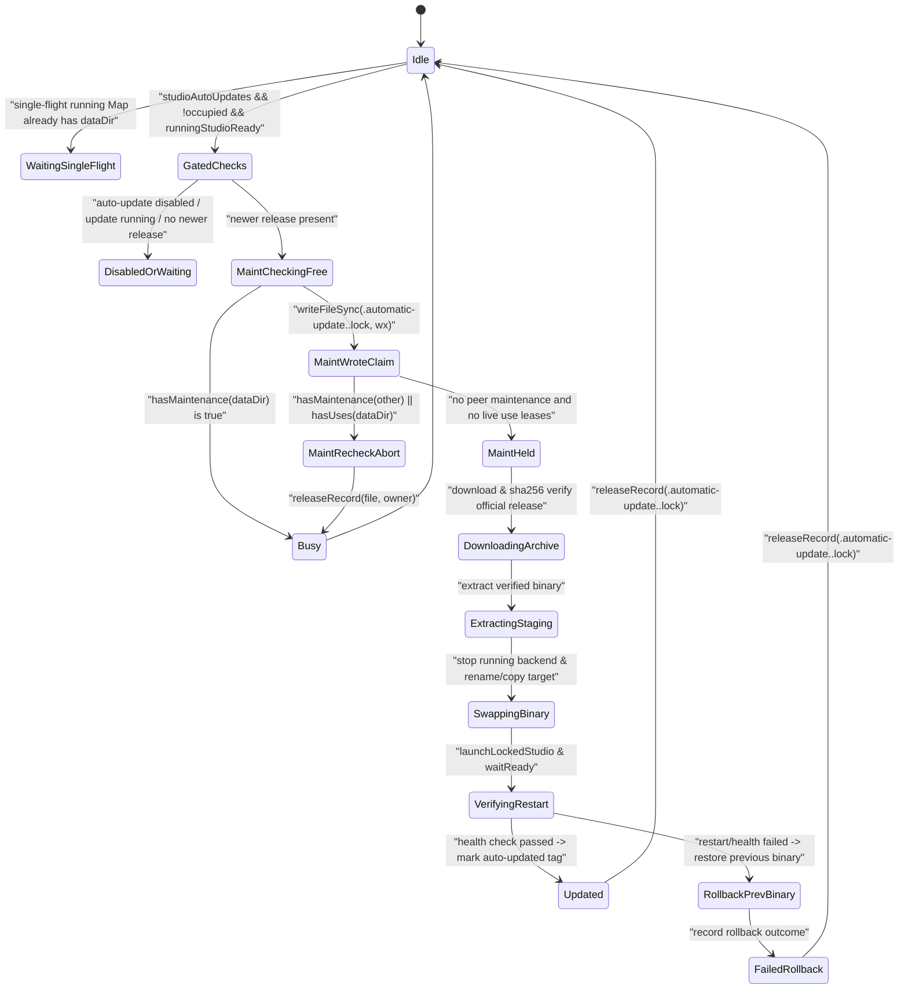

# Studio Cross-Host Lock & Auto-Update Protocol Model

Formal specification: [studio-lock-protocol.tla](studio-lock-protocol.tla)  
Executable model checker + property tests: [studio-lock-model.test.mjs](../../test/studio-lock-model.test.mjs)

## 1. Request / Stream Lease Lifecycle (`acquireStudioUse` / `holdStudioResponse`)

## 2. Background Auto-Update Gate & Replace Lifecycle (`updateStudioAutomatically` / `beginMaintenance` / `replaceStudioPackage`)

## 3. TLA+ to Runtime Code Mapping

| TLA+ Symbol | Runtime Function / File | Purpose |
| :--- | :--- | :--- |
| `LiveOwner(claim)` | `live(owner)` in `lib/studio-updates.mjs`, `processExists(pid)` + `zombie(pid)` in `lib/proc.mjs` | Rejects missing PIDs, Linux `Z` zombies, and PIDs whose `/proc/<pid>/stat` starttime no longer matches `record.started`. |
| `ReclaimStaleUse` / `ReclaimStaleMaint` | `occupied(file)` & `releaseRecord(file, owner)` in `lib/studio-updates.mjs` | Re-reads the lock file right before unlinking and only unlinks if raw file text matches the scanned snapshot or `{ pid, started, token }`. |
| `UseCheckFree` -> `UseWriteClaim` -> `UseRecheckCommit` / `UseRecheckAbort` | `acquireStudioUse(options)` in `lib/studio-updates.mjs` | Write-then-recheck fencing against concurrent `beginMaintenance`. |
| `MaintCheckFree` -> `MaintWriteClaim` -> `MaintRecheckCommit` / `MaintRecheckAbort` | `beginMaintenance(dataDir)` in `lib/studio-updates.mjs` | Unique `.automatic-update.<token>.lock` + double scan (`hasMaintenance(other) \|\| hasUses`) prevents split-brain upgrades or clobbering active requests. |
| `MaintHeld` -> `Updated` / `RollbackPrevBinary` | `withStudioUpdate` & `replaceStudioPackage` in `lib/studio-native.mjs` | Atomic package swap with backup restore on restart failure. |
